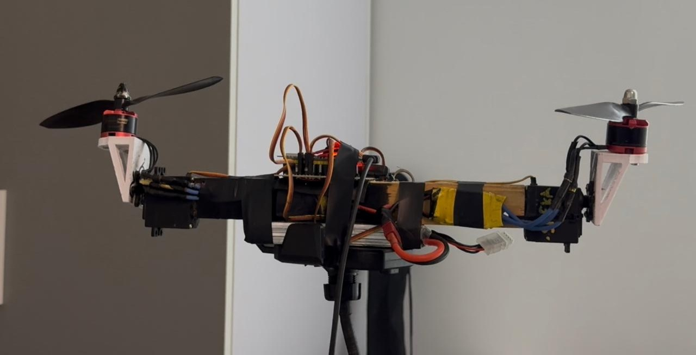
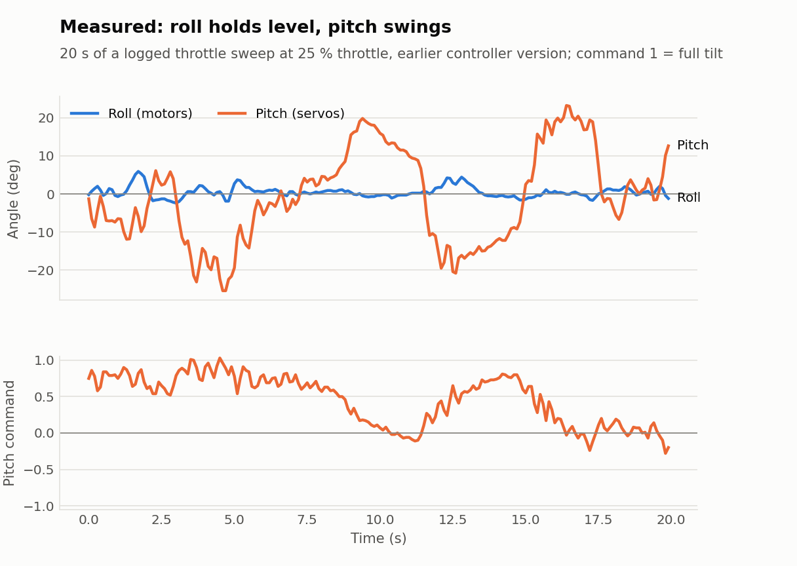
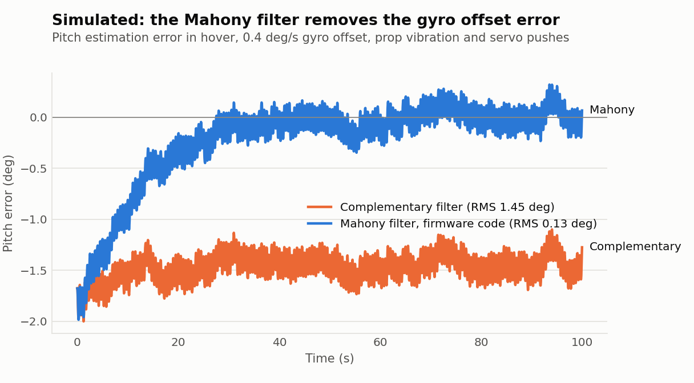
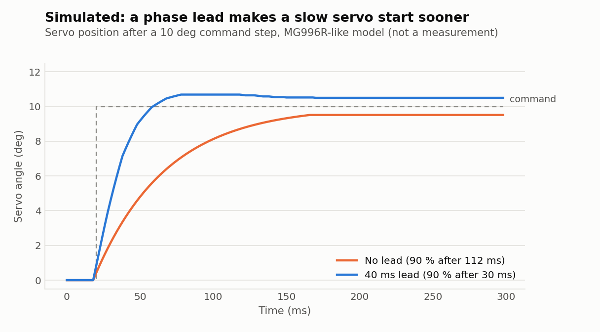

# Attitude Control of a Tilt-Rotor Bicopter on an ESP32-S3

**Mohammed Abdelsabour** · 2026



## Abstract

This repository contains the flight controller firmware for a small tilt-rotor bicopter: an aircraft with only
two rotors, each mounted on a servo that tilts it forward and back. The controller runs on an ESP32-S3
PowerFeather, reads a FlySky receiver and an MPU6050 inertial sensor, and closes a 500 Hz cascaded attitude
loop that drives two ESCs and two MG996R servos. Attitude is estimated with a Mahony filter that also learns the
gyro's zero error in flight. Roll is controlled by differential thrust and has proved easy to stabilise; pitch
and yaw rely on the tilt servos, and most of the work in this project went into understanding why that axis is
so much harder and how the firmware can help. The code is written as a set of small, independent C++
libraries, and it was developed and tuned against logged data from the real model.

## 1. Introduction

Multirotors with four or more rotors control all three axes by changing rotor speeds. A bicopter cannot do that:
two rotors give enough thrust to fly, but not enough independent speed changes to steer. The usual answer is to
tilt the rotors. Tilting both rotors forward lowers the nose, tilting them in opposite directions turns the
model, and roll is still done by running one rotor faster than the other. The result is an efficient and
compact airframe, but one whose pitch and yaw depend on hobby servos that are an order of magnitude slower than
an ESC.

The goals of this work were modest and practical:

1. a flight controller for a home-built bicopter that is safe to test with and can be read and modified
   without a large autopilot code base;
2. a clear view, from logged flight data, of where the instability on the servo axes comes from;
3. firmware measures that reduce it, and an honest account of what remains a mechanical limit.

A complete write-up, with the derivations, figures and the full reference list, is available in
[docs/BiCopter_Project_Guide.pdf](docs/BiCopter_Project_Guide.pdf).

## 2. System description

### 2.1 Hardware

| Component | Part | Role |
|---|---|---|
| Flight controller | ESP32-S3 PowerFeather | 240 MHz dual core, native USB, WiFi |
| Inertial sensor | MPU6050 (GY-521) | 3-axis gyro and accelerometer over I²C |
| Radio | FlySky FS-i6 + FS-iA6B | four PWM channels |
| Tilt actuators | 2 × MG996R | tilt each rotor forward and back |
| Propulsion | 2 × brushless motor and ESC | PWM at 400 Hz |
| Servo supply | 5–6 V UBEC | keeps servo current off the controller |

Pin assignment, power wiring and sensor mounting are documented in Appendix A,
[docs/WIRING.md](docs/WIRING.md).

### 2.2 Coordinate frame

The firmware uses a single body frame: X points to the nose, Y to the left rotor and Z up. Positive roll lowers
the right side, positive pitch lowers the nose and positive yaw turns the nose to the left. The sensor's own
axes are mapped onto this frame by a rotation set in `Config.hpp`, and the build fails if that mapping is a
mirror image, which is the most common mounting mistake.

## 3. Control design

### 3.1 Actuation and mixing

Each of the four actuators serves more than one axis. With throttle $T$ and the controller outputs $u_\phi$,
$u_\theta$, $u_\psi$ for roll, pitch and yaw, the mixer computes

$$
m_L = T + u_\phi, \qquad m_R = T - u_\phi, \qquad
s_L = u_\theta - u_\psi, \qquad s_R = u_\theta + u_\psi
$$

where $m$ are the motor commands and $s$ the servo tilt commands. When a motor would exceed its range, both are
shifted together so that the roll difference is kept. A thrust curve with an exponent of 0.65 (the same model
as ArduPilot's `MOT_THST_EXPO`) linearises the propeller response, so that a roll command produces the same
torque at any throttle.

### 3.2 Attitude estimation

On a bicopter the accelerometer measures mostly the direction of the rotor thrust, which moves with every servo
correction, so it can only be trusted slowly. The estimator is a Mahony filter on a quaternion. The gyro is
integrated as the primary source, and the accelerometer, after a second-order 10 Hz low-pass filter, slowly
steers the estimate towards the measured direction of gravity:

$$
\mathbf{e} = \hat{\mathbf{a}} \times \hat{\mathbf{v}}, \qquad
\mathbf{b} \mathrel{+}= k_i\, w\, \mathbf{e}\, \Delta t, \qquad
\boldsymbol{\omega}' = \boldsymbol{\omega} + k_p\, w\, \mathbf{e} + \mathbf{b}
$$

with $k_p = 1/3\ \text{s}^{-1}$ and $k_i = k_p / 15\ \text{s}$. The weight $w$ falls linearly from 1 at
exactly 1 g to 0 at 0.8 g and 1.2 g, so the accelerometer is ignored while the model is accelerating. The
integral term $\mathbf{b}$ learns the gyro's zero error during flight. In simulation, with gyro errors of 0.4–0.6 °/s
and propeller vibration, this reduced the attitude error from about 1.5° (the complementary filter used
earlier) to about 0.1° (Figure 2 in section 5).

### 3.3 Cascaded attitude control

Each axis uses two loops in series. The outer loop turns the angle error into a desired rotation rate, and the
inner loop drives the actuators so that the gyro follows that rate:

$$
\dot{\theta}^{*} = K_\theta\,(\theta^{*} - \theta), \qquad
u_\theta = K_p e + K_i \!\int e\,dt - K_d \,\dot{\omega}, \qquad e = \dot{\theta}^{*} - \omega
$$

The D term acts on the measurement rather than the error, so fast stick movements do not cause a kick, and the
I term stops integrating while the output is saturated. On the servo axes the gyro is low-pass filtered at
40 Hz (pitch) and 25 Hz (yaw), the servo commands at 30 Hz, and the servos are updated at 100 Hz. With the yaw
stick centred, an outer heading loop holds the current heading.

### 3.4 Take-off logic and safety

While the model is still on the ground the frame cannot respond to corrections, so any integrator running there
keeps adding correction against the ground. The firmware therefore treats the model as landed until the
throttle reaches a lift-off value, and only then enables the I terms, heading hold and roll on the motors. The
remaining safety measures follow common practice: outputs are set to "motor off" before anything else runs,
arming is refused unless the radio, sensor, throttle and attitude are all in order, a lost radio link stops the
motors, the model disarms after 15 s at idle or when it stays tilted past 60°, and a 300 ms watchdog resets the
processor if the control loop ever stalls.

## 4. Implementation

The firmware is a PlatformIO project for the Arduino framework. The sketch only connects the parts and runs the
500 Hz loop; every function lives in its own library with one header and one source file. None of the libraries
include the project configuration. Each one takes a small settings structure, which the sketch fills in from
`include/Config.hpp`, so that the estimator, the filters and the PID can be compiled and tested on a PC.

```
bi_copter_firmware/
├── platformio.ini              build environments: flight firmware and ESC calibration
├── include/Config.hpp          all settings: pins, radio, limits, filters, gains
├── src/bi_copter_firmware.ino  setup() and the 500 Hz control loop
├── lib/
│   ├── Mpu6050/                sensor driver, gyro calibration, axis mapping
│   ├── AttitudeEstimator/      Mahony filter
│   ├── BiquadFilter/           second-order low-pass filter
│   ├── Pt1Filter/              first-order low-pass filter
│   ├── Pid/                    rate controller
│   ├── LeadCompensator/        optional phase lead for the servos
│   ├── RcPwmInput/             receiver pulses measured by the MCPWM capture hardware
│   ├── StickInput/             stick scaling, failsafe, arming gestures
│   ├── BiCopterMixer/          four-actuator mixer
│   ├── PwmOutput/              servo and ESC pulses on the LEDC peripheral
│   ├── FlightController/       state machine, safety checks, control laws
│   ├── Settings/               calibration and gains stored in flash
│   ├── SerialConsole/          USB command line and live data streams
│   └── TuningWeb/              WiFi tuning page and flight recorder
├── CITATION.cff                citation metadata
├── tools/
│   ├── flight_log.py           records the console stream during a test
│   ├── make_figures.py         builds the result figures from data and simulation
│   ├── make_guide.py           generates the PDF guide
│   └── sim/attitude_sim.cpp    attitude filter simulation using the firmware code
└── docs/
    ├── BiCopter_Project_Guide.pdf
    ├── WIRING.md               Appendix A: wiring
    ├── SETUP_AND_TUNING.md     Appendix B: setup and tuning
    ├── figures/                result figures (Figures 1-3)
    ├── data/                   flight log used for Figure 1
    └── media/                  photograph and test flight video
```

Two tools supported the development. A USB console streams the controller's internal state ten times a second
and accepts commands for calibration and gain changes, and a small web page served by the ESP32 over its own
WiFi network shows the attitude live, changes gains from a phone and records flights to a `.csv` file. Nearly
every design decision described above was made after reading such a recording.

## 5. Experimental results

The video below shows a tethered hover test: the model lifts off the hand and the controller keeps it level
while the servos continuously correct pitch. Click the clip for the full 16-second recording.

[](docs/media/bi_test_2.mp4)

The logged tests produced the following observations, in the order in which they were found.

**Sensor.** The MPU6050 on this build read 1.42 g at rest. With the accelerometer's trust window at 0.8–1.2 g
it was rejected permanently and the attitude drifted. The 0.43 g offset on the Z axis is now measured at every
start-up and removed.

**Roll and pitch.** Figure 1 shows 20 seconds of a logged throttle sweep with an earlier version of the
controller. The difference between the two axes is the central result of this project. Roll, driven by the
motors, stays within ±6° of level (standard deviation 1.4°). Pitch, driven by the servos, swings by up to
±25° in slow excursions lasting several seconds with faster wobbles on top (standard deviation 12°), and the
pitch command spends a third of the window above 70 % of full tilt.



*Figure 1. Measured roll and pitch angle (top) and the pitch servo command (bottom), 20 s of a logged throttle
sweep at 25 % throttle. Source data: [docs/data/](docs/data/).*

Two causes of the pitch behaviour were identified. The first is mechanical: the centre of gravity sat behind
the rotor axis, so the servos had to hold the rotors 10–25° forward just to stay level, which is visible in
Figure 1 as a pitch command that stays positive for long periods and leaves little travel for corrections. The
second was a controller effect: with the model still on the ground the pitch integrator built up to about two
thirds of full command before lift-off, so the model shot forward as it left the ground. The lift-off logic in
section 3.4 removed the second cause.

**Attitude estimation.** Figure 2 compares the complementary filter used earlier with the Mahony filter now in
the firmware, both running on the same simulated hover with a 0.4 °/s gyro offset, propeller vibration and the
small accelerations caused by servo corrections. The simulation calls the firmware's own estimator code. The
complementary filter settles with a constant error of about 1.5°, the gyro offset multiplied by its 3 s time
constant. The Mahony filter learns the offset within about 30 s and its error then stays near zero
(RMS 0.13° against 1.45°).



*Figure 2. Simulated pitch estimation error of the earlier complementary filter and the Mahony filter
(firmware code), [tools/sim/attitude_sim.cpp](tools/sim/attitude_sim.cpp).*

**Servo response.** In a simple MG996R-like servo model, a 10° command step reaches 90 % after about 110 ms.
With the 40 ms phase lead in the firmware it does so after about 30 ms, at the cost of a small overshoot
(Figure 3). On the real model, combined with a higher pitch gain, the lead made the frame vibrate. A likely contributor is the reaction torque of the motor mounts when the servos start
to move quickly, which has also been described for other tilt-rotor designs. The lead is therefore switched
off by default, and the pitch axis uses a plain PID with a small integral gain, the same kind of controller
that other MG996R bicopters fly with.



*Figure 3. Simulated response of an MG996R-like servo to a 10° step, with and without the 40 ms phase lead.
This is a model, not a measurement.*

All three figures are generated by [tools/make_figures.py](tools/make_figures.py) from the recorded log and
the simulations, so they can be rebuilt after new tests.

## 6. Discussion and limitations

The results point to one conclusion: on a tilt-rotor bicopter the pitch axis is limited far more by mechanics
than by the controller. Its control torque is the thrust multiplied by the tilt and by the height of the rotors
above the centre of gravity, a much shorter lever than the arm that roll acts through. The servos are slow and
have free play, and every pitch correction also pushes the model forward or back. A low centre of gravity, a
front-to-back balance that leaves the rotors upright in hover, and a linkage without play matter more for
stability than any gain.

The controller holds attitude and heading but not position, so the model drifts slowly with air currents and
small level errors, and indoor flight still needs the pilot's correction.

## 7. Future work

- Faster digital servos (0.06–0.10 s per 60°) driven at 200 Hz or more.
- An optical-flow sensor and a laser rangefinder for position and height hold indoors.
- Battery voltage measurement, to keep the throttle response constant as the battery discharges.
- Feed-forward from the roll motor command into yaw, to cancel the rotor torque coupling.

## 8. Reproducing this work

The firmware builds with [PlatformIO](https://platformio.org):

```bash
pio run -e powerfeather -t upload     # build and flash
pio device monitor                    # console; type h for help
```

A four-channel radio has no switches, so arming uses the sticks: throttle down with yaw fully right arms, yaw
fully left disarms, and holding the pitch stick fully forward or back for three seconds while disarmed stores
the current attitude as level. The tuning page is reached by joining the WiFi network `BiCopter` (password
`bicopter123`) and opening `http://192.168.4.1`.

Before the first flight, follow Appendix B, [docs/SETUP_AND_TUNING.md](docs/SETUP_AND_TUNING.md), with the
propellers removed. It checks every direction (sticks, sensor, servos and motors) one at a time, and it describes how to
set the receiver failsafe on the FS-i6. That step is essential: without it the receiver keeps repeating the last
stick positions when the link drops, and the firmware cannot detect the loss.

## References

1. R. Mahony, T. Hamel and J.-M. Pflimlin, "Nonlinear complementary filters on the special orthogonal group",
   *IEEE Transactions on Automatic Control*, vol. 53, no. 5, 2008.
2. S. O. H. Madgwick, "An efficient orientation filter for inertial and inertial/magnetic sensor arrays",
   technical report, University of Bristol, 2010.
3. K. J. Åström and R. M. Murray, *Feedback Systems: An Introduction for Scientists and Engineers*, Princeton
   University Press, 2008.
4. Q. Quan, *Introduction to Multicopter Design and Control*, Springer, 2017.
5. Y. Qin, W. Xu, A. Lee and F. Zhang, "Gemini: A compact yet efficient bi-copter UAV for indoor applications",
   *IEEE Robotics and Automation Letters*, vol. 5, no. 2, 2020.
6. ArduPilot, *Tilt rotor planes* (bicopter frame class),
   https://ardupilot.org/plane/docs/guide-tilt-rotor.html
7. P. Cook, *PlainFlightController*, https://github.com/plainFlight/plainFlightController
8. N. Rehm, *dRehmFlight VTOL flight controller*, https://github.com/nickrehm/dRehmFlight
9. Espressif Systems, *ESP32-S3 Technical Reference Manual* (MCPWM and LED PWM controller).
10. InvenSense, *MPU-6000 and MPU-6050 Product Specification* and *Register Map and Descriptions*.

The PDF guide lists the remaining documentation and software references.

## Acknowledgements

The receiver capture method and the stick-centre learning follow the approach of PlainFlightController by
P. Cook.

## Citation

```bibtex
@misc{abdelsabour2026bicopter,
  author = {Mohammed Abdelsabour},
  title  = {Attitude Control of a Tilt-Rotor Bicopter on an ESP32-S3},
  year   = {2026},
  howpublished = {\url{https://github.com/mohammedabdelsaboor/BI-Copter}}
}
```
