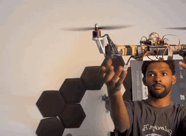

# BiCopter Flight Controller


Firmware for a small tilt-rotor bicopter, written for the ESP32-S3 PowerFeather board. Two motors give the
lift, and each motor sits on a servo that tilts it forward and back. The ESP32 reads a FlySky receiver and an
MPU6050, works out the model's attitude 500 times a second, and drives the two ESCs and the two servos to keep
it level.

The aim was a controller that is small, readable and safe enough to test
with, rather than a general purpose autopilot. Everything that matters for flying is in about 2,600
lines of C++ that you can read in an afternoon.

The full write-up (how a bicopter flies, the firmware design, the setup procedure and the references) is in
[docs/BiCopter_Project_Guide.pdf](docs/BiCopter_Project_Guide.pdf).

## Test flight

Hand-held test with the motors running: the servos tilt the motors to hold the frame level as it is moved.
Click the clip for the full 40-second video.

[](docs/media/test_flight.mp4)

## Hardware

| Part | Notes |
|---|---|
| ESP32-S3 PowerFeather | flight controller, USB for flashing and the console |
| MPU6050 (GY-521 board) | gyro + accelerometer on I2C |
| FlySky FS-i6 + FS-iA6B | 4 channels, one PWM wire per channel |
| 2 × MG996R servos | tilt the motors |
| 2 × brushless motor + ESC | standard PWM ESCs, 400 Hz |
| 5–6 V UBEC | separate supply for the servos |

Pins, power wiring and IMU mounting are in [docs/WIRING.md](docs/WIRING.md).

## How it controls the model

A bicopter has only four actuators, so each one does more than one job:

- **Roll** (tipping left/right) comes from running one motor faster than the other.
- **Pitch** (nose up/down) comes from tilting both motors forward or back together.
- **Yaw** (turning) comes from tilting the motors in opposite directions.

The sticks command an angle for roll and pitch (the model levels itself when you let go) and a turn rate
for yaw. With the yaw stick centred, the firmware also holds the heading.

## Workspace

```
bi_copter_firmware/
├── platformio.ini            build settings: flight firmware and an ESC calibration build
├── include/Config.hpp        every setting in one file: pins, radio, limits, PID gains
├── src/bi_copter_firmware.ino  setup() and the 500 Hz loop, nothing else
├── lib/                      one folder per job, each a .hpp + .cpp pair
│   ├── Mpu6050/              sensor driver, gyro calibration, axis remapping
│   ├── RcPwmInput/           measures the 4 receiver pulses with the MCPWM capture hardware
│   ├── StickInput/           turns pulses into stick values, failsafe, arm/disarm gestures
│   ├── AttitudeEstimator/    roll and pitch: Mahony filter fusing gyro + accelerometer
│   ├── BiquadFilter/         second order low pass (accelerometer vibration)
│   ├── LeadCompensator/      optional phase lead for the servo commands
│   ├── Pt1Filter/            low pass filter
│   ├── Pid/                  rate PID controller
│   ├── PwmOutput/            servo/ESC pulses on the LEDC peripheral
│   ├── BiCopterMixer/        roll/pitch/yaw/throttle -> 2 ESCs + 2 servos
│   ├── Settings/             level, trims and tuned gains kept in flash
│   ├── FlightController/     state machine, safety checks and the control loop
│   ├── SerialConsole/        USB commands and live data
│   └── TuningWeb/            WiFi tuning page: live angles, level, servo trims, PID gains
├── tools/
│   ├── flight_log.py         records the console to a file during a test
│   └── make_guide.py         rebuilds the PDF guide
└── docs/
    ├── media/                photo of the model, test flight video and a short GIF of it
    ├── BiCopter_Project_Guide.pdf
    ├── WIRING.md
    └── SETUP_AND_TUNING.md
```

None of the libraries include `Config.hpp`. Each one takes a small settings struct, and the sketch fills those
structs in from `Config.hpp`. That keeps every part testable on its own; the attitude filter and the PID, for
example, compile and run on a PC.

## Building and flashing

You need [PlatformIO](https://platformio.org), either the VS Code extension or the command line.

```bash
pio run -e powerfeather -t upload    # build and flash
pio device monitor                   # open the console, then type h and Enter
```

There is a second build, `esc_calibration`, that passes the throttle stick straight to the ESCs so they can
learn their range. Only use it with the propellers off.

## Flying it

There are no switches on a 4-channel setup, so arming uses the sticks:

| What | How |
|---|---|
| Arm | throttle down, yaw fully right for 1 s |
| Disarm | throttle down, yaw fully left for 1 s |
| Save level | disarmed, model level, throttle down, pitch fully forward or back for 3 s |

The board LED blinks slowly when disarmed, stays on when armed and blinks fast in failsafe.

### Tuning from a phone

The board runs its own WiFi network. Join **BiCopter** (password `bicopter123`) and open **http://192.168.4.1**:

- live attitude (artificial horizon) and a 15 s roll/pitch graph
- level calibration and servo trims, with the live tilt angle of each motor
- PID gains per axis, applied instantly and saved to flash
- hover balance: the motor tilt learned in flight, used to keep the thrust vertical
- a flight recorder that saves a .csv of the flight to the phone

Changes are refused while armed. Network name, password and power are in `include/Config.hpp`.

Before the first flight, go through [docs/SETUP_AND_TUNING.md](docs/SETUP_AND_TUNING.md) with the propellers
off. It checks every direction (sticks, sensor, servos, motors) one at a time. A single reversed direction is
the most common reason a new build flips on take-off.

## Safety

- The ESC outputs are at 1000 µs (motor off) from the very first line of `setup()`.
- Arming is refused if the radio is missing, the throttle is up, the model is tilted more than 25° or the
  sensor is not calibrated. The console says which one.
- If the radio link drops while armed, the motors stop.
- The model disarms itself after 15 s at idle, or if it stays tilted past 70° (a crash).
- A 300 ms watchdog resets the chip if the loop ever stalls. All outputs go low, so the ESCs stop.

**Set the receiver failsafe on the transmitter.** The FS-iA6B keeps repeating the last stick positions when it
loses the signal, so without that setting the firmware can't tell the link has gone. The setup guide
explains how to set it and how to test it.

## Limitations

The controller holds angle and heading, not position. In a breeze the model slides slowly, and the pilot has
to correct for that. Holding a fixed spot would need an optical-flow and height sensor. The MG996R servos are
also the weak point for precision: they are slow and have some free play in their gears, so a digital
metal-gear servo makes pitch and yaw noticeably tighter.

## Credits

The receiver capture approach and the stick centre learning follow ideas from
[PlainFlightController](https://github.com/plainFlight/plainFlightController) by P. Cook. The rest of the
references are listed at the end of the PDF guide.

Mohammed Abdelsabour, 2026
