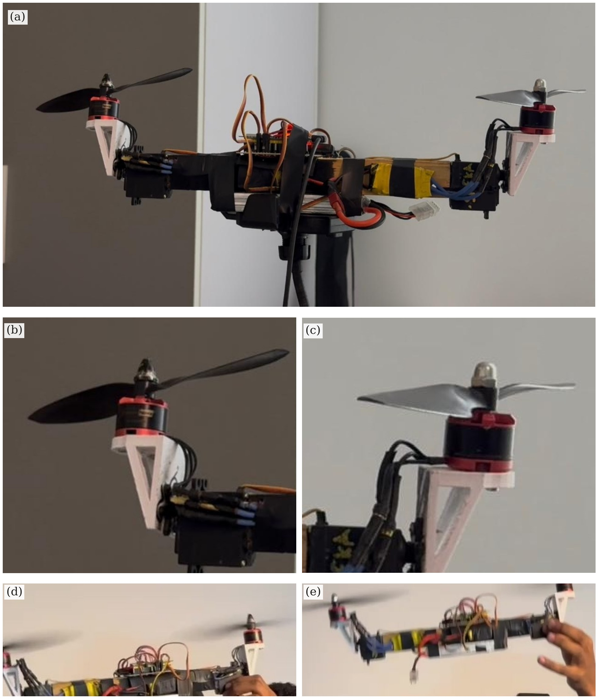

# Hardware: 3D-printed parts

The two printed parts used on the model. Both are existing designs from Thingiverse, included here unchanged
with their original licence files so the airframe can be rebuilt. Credit belongs to their authors.

*The parts on the bicopter built in this project: (b) and (c) show the left and right tilt units close up.
The designers' own photos of the parts are in each part's `images/` folder.*

| Part | Used for | Files | Author and source | Licence |
|---|---|---|---|---|
| [Brushless motor mount](3d-parts/brushless-motor-mount/) | holds each motor on its tilt shaft | STL | protorobotics, [thing:4009542](https://www.thingiverse.com/thing:4009542) | CC BY-SA |
| [Servo mount](3d-parts/servo-mount/) | holds each MG996R tilt servo on the arm | STL, STEP | sternli27, [thing:1477838](https://www.thingiverse.com/thing:1477838) | CC BY |

The licences apply to these parts only, not to the firmware. Under CC BY-SA, a modified version of the motor
mount has to be shared under the same licence.

For the pitch axis, keep the motor and propeller as close as possible to the servo's tilt axis. A heavy mount
far from the axis makes the servo slower to move it and pushes the body the wrong way each time the servo
starts moving.
